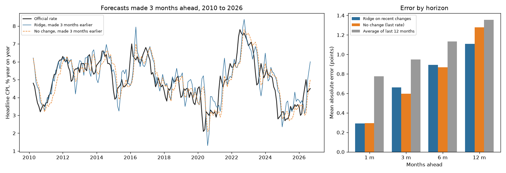

# CPI Inflation Forecast

Can a simple model forecast South African headline inflation better than assuming it stays where it is? A rolling backtest on Statistics South Africa's official monthly inflation rates, 1, 3, 6 and 12 months ahead.

## Data

| | |
| --- | --- |
| Source | Statistics South Africa, P0141 Consumer Price Index, [CPI History](https://www.statssa.gov.za/publications/P0141/CPIHistory.pdf) (Table B1 headline index, Dec 2024 = 100; Table B2 official year-on-year rates), from the [P0141 publication page](https://www.statssa.gov.za/?page_id=1854&PPN=P0141) |
| Release | September 2026 CPI, published 21 October 2026 |
| Downloaded | 25 October 2026 |
| Terms | Stats SA's [copyright and disclaimer](https://www.statssa.gov.za/?page_id=425) allows the data to be used and distributed, provided Stats SA is acknowledged as the source of the basic data and the analysis is stated to be the user's own |
| In this folder | [`CPIHistory.pdf`](CPIHistory.pdf) as downloaded, and [`cpi_headline.csv`](cpi_headline.csv) extracted from it |

Source: Statistics South Africa. The extraction, the models and every result below are my own processing of that data, not Stats SA's.

## How it works

- [`parse_cpi.py`](parse_cpi.py) reads the two tables from the PDF into [`cpi_headline.csv`](cpi_headline.csv): 693 monthly official rates (January 1969 to September 2026) and 561 index values (from January 1980). It checks that each year's months average to the annual figure, and that the official rates match the rates implied by the index from 2010 on (median gap 0.05 points, largest 0.30, from rounding; see [`parse_output.txt`](parse_output.txt)).
- [`cpi_forecast.py`](cpi_forecast.py) forecasts the official year-on-year rate. At the end of each month from January 2010, it trains on what was known by then (from January 2000, when inflation targeting began) and forecasts 1, 3, 6 and 12 months ahead. That gives about 190 to 200 forecasts per horizon, none of which saw its own outcome.
- **Model:** a ridge regression that predicts how much the rate will change, from the current rate, its change over the last 1, 3 and 12 months, and price growth over the last 3 months at an annual pace. The ridge penalty is fixed at 10 and was not tuned on the test years.
- **Baselines:** no change (next month's rate equals this month's), and the average of the last 12 months.
- **Test:** a Diebold-Mariano test of whether the model's mean absolute error really differs from the no-change forecast's, allowing for the overlap between forecasts more than a month ahead.

## Results

From [`run_output.txt`](run_output.txt). Mean absolute error, in percentage points of inflation:

| Months ahead | Ridge | No change | Average of last 12 months | p (Ridge against no change) |
| --- | --- | --- | --- | --- |
| 1 | 0.29 | 0.30 | 0.78 | 0.76 |
| 3 | 0.66 | 0.60 | 0.95 | 0.10 |
| 6 | 0.89 | 0.87 | 1.13 | 0.80 |
| 12 | 1.11 | 1.28 | 1.36 | 0.41 |

**The model does not beat "no change".** It ties at 1 month, does slightly worse at 3 and 6 months, and does better at 12 months, but none of the differences is statistically significant. Assuming inflation stays where it is, which takes no model at all, is as good as anything here. That is a common finding for inflation, and the useful result is knowing it before trusting a model that looks clever. Both clearly beat the 12-month average, which lags behind every turn.

The chart shows why. The model reads the last three months of price growth as a signal, so it reacts faster when inflation turns, but it also overshoots. In mid-2026 it forecast 5.5% to 6.0%, and inflation came in at 4.4% to 4.5%.



## Cautions

- The CPI was rebuilt in January 2009 (new basket and weights, all urban areas instead of primary urban areas), and Stats SA linked the old and new index into one series. The official rates for 2009 compare against the old basket.
- Only past inflation goes into the model. The interest rate, the rand, fuel and food prices drive most of what happens next, and none of them is used.
- The 2010–2026 test period includes the pandemic and the 2022 spike. A different period could rank the forecasts differently.
- This is a backtest of a method, not a forecast of future inflation.

## Run it

From this folder, with the packages in [`requirements.txt`](../requirements.txt):

```bash
python parse_cpi.py
python cpi_forecast.py
```
