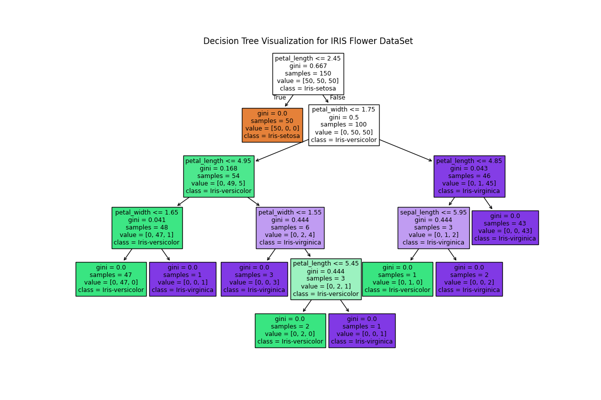

# Iris Flower Classification Model

Classifies iris flowers into three species (setosa, versicolor, virginica) from four measurements: sepal length and width, and petal length and width. The data is the classic Iris dataset (`IRIS.csv`, 150 flowers).

## How it works

- [`Iris-Flower-Selection-Model.py`](Iris-Flower-Selection-Model.py) splits the data 80/20 with a fixed random seed, trains a decision tree, prints accuracy, the classification report and the confusion matrix, and saves the model to `iris_flower_selection_model.pkl`.
- [`Decision-Tree.py`](Decision-Tree.py) draws the tree to `iris_decision_tree.png`.

## Results

On the 30 test flowers, every one was classified correctly:

```
                 precision    recall  f1-score   support
    Iris-setosa       1.00      1.00      1.00        10
Iris-versicolor       1.00      1.00      1.00         9
 Iris-virginica       1.00      1.00      1.00        11
```

That says more about the dataset than about the model. Iris is famously easy to separate on petal size, and 30 test flowers is a small sample. On harder data, a perfect score should be treated as a sign of leakage until proven otherwise.



## Run it

From this folder:

```bash
python Iris-Flower-Selection-Model.py
python Decision-Tree.py
```
