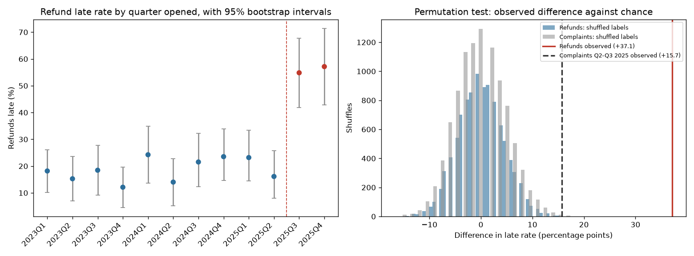

# Did the second sign-off slow refunds?

A hypothesis-testing project on the synthetic service-desk data from [SA Turnaround](https://github.com/nurah-kamal/reporting-and-bi/tree/main/sa-turnaround). From 1 July 2025, refunds at the made-up desk need a second sign-off. Did that make them slower, or is the jump something chance could produce? And is the bump in late complaints in the middle of 2025 real?

**The data is synthetic and the refund change was planted.** [`requests.csv`](requests.csv) is a copy of sa-turnaround's [`data/sample/requests.csv`](https://github.com/nurah-kamal/reporting-and-bi/blob/main/sa-turnaround/data/sample/requests.csv) (5,719 invented requests from 2023 to 2025, no people in it). Its generator adds 1 to 3 working days to every refund opened from 1 July 2025 and changes nothing else. So the right answer is known in advance, and the point is to check that the tests find it, and only it.

## How it works

- [`sa_calendar.py`](sa_calendar.py) is a Python port of sa-turnaround's South African public holiday and working-day rules ([HOLIDAY_RULES.md](https://github.com/nurah-kamal/reporting-and-bi/blob/main/sa-turnaround/docs/HOLIDAY_RULES.md)). As a check, it reproduces the late rates that sa-turnaround's SQL publishes: refunds 16.1%, 54.8% and 57.1% late in 2025 Q2, Q3 and Q4, and complaints 29.7%, 34.2% and 16.2%.
- [`sign_off_test.py`](sign_off_test.py) measures each closed request in working days and marks it late when it took longer than its category's target (5 working days for refunds and complaints).
- **Permutation test:** shuffle the before and after labels 10,000 times and count how often a shuffled difference is at least as big as the real one. That gives a p-value without assuming any distribution.
- **Bootstrap intervals:** resample each group with replacement 10,000 times for 95% confidence intervals on the late rate, the average turnaround, and the difference.
- The same tests run on the other categories across 1 July 2025, which should not move, and on the complaints bump.

## Results

From [`run_output.txt`](run_output.txt):

| Refunds | Opened before 1 July 2025 | Opened from 1 July 2025 | Difference (95% CI) | Permutation p |
| --- | --- | --- | --- | --- |
| Late | 18.7% (15.8 to 21.7), n = 678 | 55.9% (46.8 to 64.9), n = 111 | +37.1 points (+27.1 to +47.0) | < 0.001 |
| Average turnaround | 4.1 working days (4.0 to 4.2) | 6.1 working days (5.7 to 6.5) | +2.0 days (+1.6 to +2.4) | < 0.001 |

None of 10,000 shuffles gave a difference as big as the real one, so the p-value is at the floor the test can show (1 in 10,001). The extra 2.0 working days matches what was planted: 1 to 3 extra days, 2 on average. The other categories did not move across the same date: account changes −2.1 points (p = 0.45), billing queries −2.4 (p = 0.40), document requests −1.5 (p = 0.67) and complaints +8.0 (p = 0.11).



### The complaints bump

Complaints were 32.0% late in 2025 Q2–Q3 against 16.3% in the other quarters. Nothing was planted there: in the generator, a complaint's chance of being late is 17.4% in every quarter. Yet the tests do not call it noise:

| Test | p |
| --- | --- |
| Q2–Q3 2025 against the other quarters (late rate) | 0.002 |
| Scan test: biggest bump in any two neighbouring quarters, complaints only | 0.007 |
| Scan test: biggest bump in any two neighbouring quarters, any of the four other categories | 0.007 |
| 2025 Q4 alone against the quarters before Q2 (16.2% against 16.3%) | 1.0 |

The first test is too generous, because the window was picked after looking at the table. The scan test corrects for that by asking how often chance alone produces a bump this big anywhere in the series, and it still comes out at about 1 in 140. So this is a false positive: a rare run of bad luck that a significance test cannot tell apart from a real change.

What does tell them apart is the next quarter. Refunds stayed up in Q4 (57.1% against 19.0% before Q2, p < 0.001), but complaints fell straight back to 16.2%. A real change lasts, and a fluke does not. That is the difference between the two findings, and it is why sa-turnaround reports refunds and not complaints.

## Cautions

- The data is synthetic. This shows the method, not anything about a real desk.
- Only closed requests are measured. 13 requests were still open on 31 December 2025 (5 refunds, 2 complaints), and they are likely the slowest, so the late rates for 2025 Q4 are slightly low.
- The before period is two and a half years and the after period six months, so the after estimates are much less precise, as the wider intervals show.
- A p-value is only as honest as the question was set before looking. The complaints test is the example.

## Run it

From this folder, with the packages in [`requirements.txt`](../requirements.txt):

```bash
python sign_off_test.py
```

It takes a few seconds and prints the figures above.
