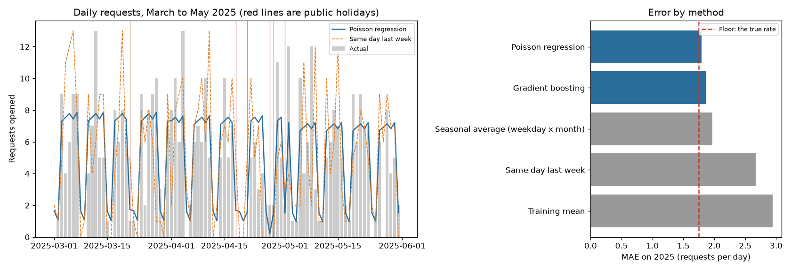

# Request Volume Forecast

How many requests will a service desk get tomorrow? A forecast of daily request volume from the day of the week, the month and South African public holidays, checked against the naive forecasts a team would otherwise use.

**The data is synthetic.** [`requests.csv`](requests.csv) is a copy of the invented service-desk data from [SA Turnaround](https://github.com/nurah-kamal/reporting-and-bi/tree/main/sa-turnaround) ([`data/sample/requests.csv`](https://github.com/nurah-kamal/reporting-and-bi/blob/main/sa-turnaround/data/sample/requests.csv), 5,719 requests from 2023 to 2025, no people in it). Its generator draws each day's count from a known rate: about 7 a working day, busier in January and quieter in December, and only a few web-form requests on weekends and public holidays. Because that rate is known, the forecast can be compared with the best any model could do.

## How it works

- [`sa_calendar.py`](sa_calendar.py) is a Python port of sa-turnaround's public holiday rules ([HOLIDAY_RULES.md](https://github.com/nurah-kamal/reporting-and-bi/blob/main/sa-turnaround/docs/HOLIDAY_RULES.md)): the statutory holidays, the Sunday rule and declared days such as election days.
- [`volume_forecast.py`](volume_forecast.py) counts requests per day, including days with none, and gives each day three features: day of the week, month, and whether it is a public holiday.
- **Time-based split:** the models learn from 2023 and 2024 and are tested on all of 2025. A random split would let the model see days on either side of each test day. Inside 2023–2024, a rolling 5-fold cross-validation (each fold tested only on days after its training data) checks that the score is stable.
- **Models:** a Poisson regression on the one-hot features (counts are whole numbers, and Poisson regression models the rate on a log scale) and a gradient-boosted tree with a Poisson loss.
- **Baselines:** the same day last week; the average for that weekday in that month over the training years; and the overall training average.

## Results

From [`run_output.txt`](run_output.txt). Mean absolute error on 2025, in requests per day:

| Forecast | MAE |
| --- | --- |
| Poisson regression | 1.80 |
| Gradient boosting | 1.87 |
| Seasonal average (weekday × month) | 1.97 |
| Same day last week | 2.67 |
| Training average | 2.94 |
| The true rate the data was drawn from (not available in real life) | 1.75 |

In the rolling cross-validation on 2023–2024, the Poisson regression averaged 1.95 (folds 1.84 to 2.12) and gradient boosting 2.08.

The Poisson regression is off by about 1.8 requests a day, against 2.7 for "same as last week". It comes within 0.05 of the true rate, so almost all of what is left is chance: on a day with an expected 7 requests, the actual count still swings by a few either way. The seasonal average is close behind, because the volume pattern really is just weekday and month. Where it falls down is holidays. On the 11 weekday public holidays in 2025, which averaged 1.3 requests, the errors were:

| Forecast | MAE on weekday holidays |
| --- | --- |
| Poisson regression | 1.18 |
| Same day last week | 3.00 |
| Seasonal average | 5.41 |

The seasonal average expects an ordinary working day, so a staffing plan built on it would roster a full team on Workers' Day.



## Cautions

- The data is synthetic, and its pattern is exactly the one the features describe, so this is the best case. Real volume has trends, campaigns and outages that none of these features know about.
- With only 3 years, each month appears twice in training, so the month effects are rough.
- The holiday list's declared days are checked for 2009–2026 only (see sa-turnaround's holiday rules).

## Run it

From this folder, with the packages in [`requirements.txt`](../requirements.txt):

```bash
python volume_forecast.py
```
