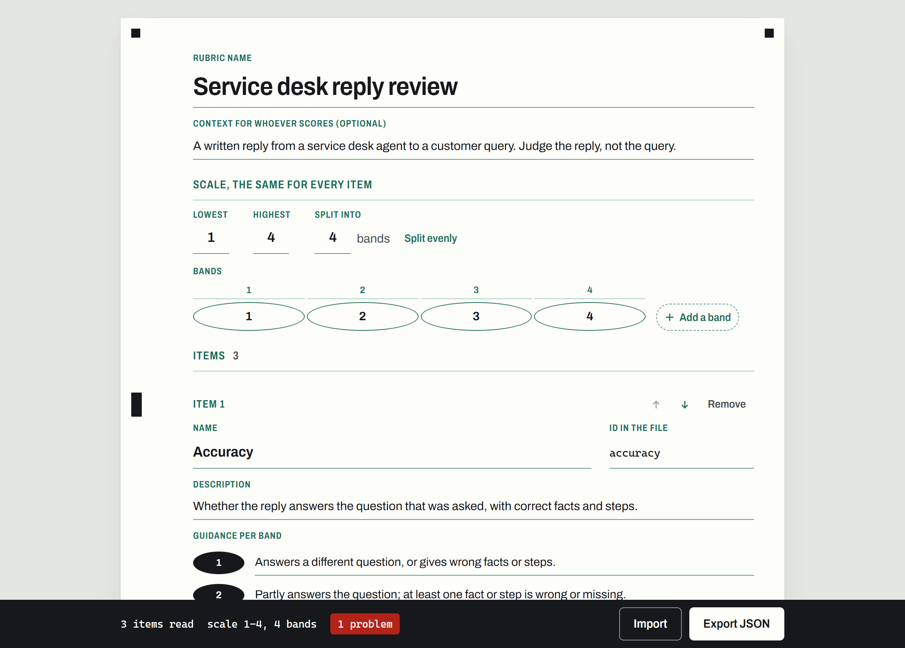

# rubric-builder

[](https://github.com/nurah-kamal/statistical-modelling/actions/workflows/rubric-builder.yml) 14 tests

**Write a scoring rubric on one screen: name the items, set the scale once, divide it into bands, and write what work in each band looks like. The sheet checks itself as you type and exports the exact JSON file [rubric-eval](../rubric-eval/) scores with. A test takes rubric-eval's real rubric through the form and back and gets the same file out, byte for byte.**

**Live:** https://nurah-kamal.github.io/statistical-modelling/rubric-builder/



## What it shows

| | |
| --- | --- |
| **Items** | Add, remove, name and describe items, and put them in order by dragging the black mark in the margin, with the arrow buttons, or with the up and down keys on the mark. A moved item slides into place and stays highlighted until the next edit. |
| **Scale** | Lowest and highest score, set once for the whole rubric, and bands such as `1-2` or `3`. **Split evenly** divides the scale into a chosen number of bands. A strip of score cells shows which scores no band covers and which are in two. |
| **Guidance** | One box per band for every item. The band's bubble fills in once something is written beside it, so an unfinished item shows at a glance. |
| **Checks** | An item missing guidance for a band, a gap or an overlap in the bands, a band off the scale, duplicate item names, an id rubric-eval wouldn't accept, a missing name or description. Each one is shown at the field, counted in the read-out, and listed under it with a link that goes to the field. |
| **Export and import** | Export downloads the rubric as JSON, and refuses while anything is wrong, so a downloaded file always loads. Import takes JSON or YAML, including rubric-eval's own `.yaml`, and rebuilds the form. Nothing is sent anywhere: the file is made in the browser. |

## The part worth copying

- **The test that matters is the round trip.** `tests/rubric.test.js` reads rubric-eval's real `rubrics/ellipse.yaml`, loads it into the form, exports it, and checks the JSON is identical to the original, key for key and in the same order. It then hands the export to rubric-eval's own `validateRubric`. If either project's format drifts, CI fails.
- **The checks agree with rubric-eval's.** One test breaks the ELLIPSE rubric nine ways (a gap, an overlap, a band off the scale, a band that isn't a number, a backwards scale, a bad id, a repeated id, a missing description, no items) and asserts that this form and rubric-eval both refuse every one.
- **No converter needed.** rubric-eval reads its rubric with a YAML parser, and JSON is valid YAML, so the exported `.json` loads with `--rubric` as it is.
- **Keep the logic out of the components.** `src/rubric.js` holds the conversions and every check, with no React in it, so the tests run in plain Node in under a second.

## How it is built

| | |
| --- | --- |
| **Form model** | [src/rubric.js](src/rubric.js): `fromRubric` and `toRubric` convert between rubric-eval's shape (`name`, `context`, `scale`, `items` with `id`, `name`, `description` and `bands`) and the form, where bands are set once and each item holds guidance per band. `validate` returns each problem with the field it belongs to. |
| **Screen** | [src/App.jsx](src/App.jsx) and [src/styles.css](src/styles.css): React 19, no component library. The sheet borrows from a machine-read answer sheet: printed guides in one green ink, what you write in black, timing marks down the margin, a bubble per band, and a read-out strip along the bottom. |
| **Reordering** | Pointer events on the margin mark, so dragging works the same with a mouse, a pen or a finger. The arrow keys and the arrow buttons do the same job without dragging, and a screen reader hears the new position. |
| **Ids** | Each item's id is made from its name (`Word choice` becomes `word_choice`) until it is edited by hand. rubric-eval needs lowercase letters, digits and `_`. |
| **Build** | Vite 8. The ELLIPSE example is read straight from `../rubric-eval/rubrics/ellipse.yaml` at build time, so there is one copy. Archivo is bundled from Fontsource rather than loaded from a font service. |
| **Tests** | 14 with `node:test`: the round trip, the export loading in rubric-eval, re-importing an export, each check, agreement with rubric-eval on nine broken rubrics, ids from names, band parsing and even splits, moving items, refusing an import whose items use different bands, and what a blank sheet still needs. |
| **CI** | [.github/workflows/rubric-builder.yml](../.github/workflows/rubric-builder.yml) runs the audit, the tests and the build when this folder, rubric-eval's rubrics or its rubric loader change. [.github/workflows/pages.yml](../.github/workflows/pages.yml) publishes the built page. Actions are pinned to exact commits. |

## Try it on your own machine

Node 22 or later.

```bash
cd rubric-eval && npm ci && cd ..   # the round-trip test uses rubric-eval's validator
cd rubric-builder
npm ci
npm test
npm run dev                          # then open the address it prints
```

To score with a rubric you made: export it, put the file anywhere, and in rubric-eval run `npm run eval -- --rubric path/to/your-rubric.json`.

## Things worth knowing

**Bands are shared by every item.** rubric-eval allows each item its own bands, but a rubric where they differ is hard to score consistently, so the form sets them once. Importing a rubric whose items use different bands is refused, with the item named.

**Changing the bands keeps guidance by position.** Splitting the scale again, or editing a band's range, leaves each band's guidance in place. Removing a band removes its guidance from every item.

**The ELLIPSE example keeps its licence.** It is rubric-eval's rubric, adapted from the ELLIPSE corpus under CC BY-NC-SA 4.0, and the page says so. The service desk example the sheet opens with is invented.

**Nothing is saved between visits.** Closing the tab loses unsaved work. Export to keep it.

## Folders

```
src/rubric.js       the form model, conversions and checks
src/App.jsx         the sheet
src/styles.css      its styles
src/sample.js       the invented example it opens with
tests/              14 tests
docs/sheet.png      the screenshot above
site-root.html      the Pages front door, which forwards to the tool
```

## Licence

MIT, in the [repository root](../LICENSE). The ELLIPSE example is CC BY-NC-SA 4.0; see [rubric-eval's data notes](../rubric-eval/data/README.md).
